# IoT-Based Smart Energy Meter with SMS Alert

An ESP32-based smart energy meter that measures AC mains parameters with a PZEM-004T module, shows them on a local LCD, streams them over MQTT to a live web dashboard, and sends an SMS alert when an over-voltage condition is detected.

This project was developed as the Design Lab project for the course EE 396 at the Indian Institute of Technology Guwahati, under the guidance of Prof. Gaurav Trivedi ([https://iitg.ac.in/trivedi](https://iitg.ac.in/trivedi)).

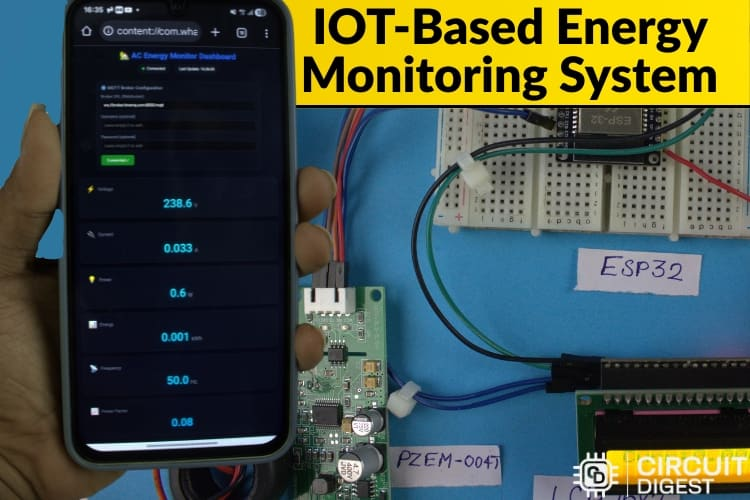

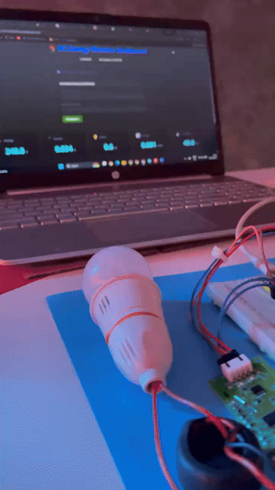

## Table of Contents

1. [Overview](#overview)
2. [Features](#features)
3. [System Architecture](#system-architecture)
4. [Hardware](#hardware)
5. [Circuit and Wiring](#circuit-and-wiring)
6. [How It Works](#how-it-works)
7. [Firmware Walkthrough](#firmware-walkthrough)
8. [Web Dashboard](#web-dashboard)
9. [SMS Alerts](#sms-alerts)
10. [Setup and Installation](#setup-and-installation)
11. [Repository Structure](#repository-structure)
12. [Safety Notes](#safety-notes)
13. [Applications](#applications)
14. [Future Improvements](#future-improvements)
15. [FAQ](#faq)
16. [Acknowledgements](#acknowledgements)

## Overview

Monitoring electricity usage normally requires a physical visit to the meter. This project makes the readings available remotely and in real time, and warns the user by SMS when the supply voltage becomes dangerously high.

The ESP32 microcontroller reads six electrical quantities from a PZEM-004T energy module over UART, then does three things with them:

1. Shows them on a 16x2 I2C LCD, cycling through three screens.
2. Publishes them every two seconds to an MQTT broker, where a browser-based dashboard displays live values and charts.
3. Sends an SMS through the Circuit Digest Cloud API if the voltage exceeds 250 V.

The firmware also detects when mains power is lost and immediately reports zeros instead of stale values, while keeping the accumulated energy reading.

## Features

- Real-time measurement of voltage, current, active power, energy, frequency and power factor.
- Local display on a 16x2 I2C LCD that rotates through three screens.
- MQTT publishing of each parameter on its own topic every 2 seconds.
- Browser dashboard with live gauges, values and charts, connected over MQTT WebSockets.
- SMS alert on over-voltage, with a 60 second cooldown to prevent message spam.
- Instant power-off detection: all instantaneous readings drop to zero as soon as the AC supply disappears, with a 2 second debounce for the logged state change.
- No manual calibration, because the PZEM-004T is factory calibrated.

## System Architecture

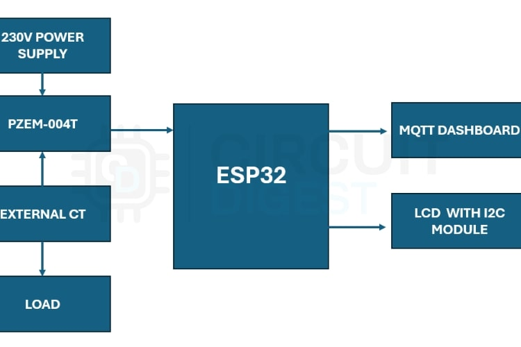

```
AC Load
   |
PZEM-004T (voltage input + external CT on live wire)
   |  UART (Modbus-RTU, 9600 baud)
ESP32
   |-- I2C --------------> 16x2 LCD
   |-- Wi-Fi / MQTT -----> MQTT broker --> Web dashboard (Dashboard.html)
   |-- Wi-Fi / HTTPS ----> Circuit Digest Cloud API --> SMS to mobile phone
```

## Hardware

| No. | Component | Quantity |
|-----|-----------|----------|
| 1 | ESP32 development board | 1 |
| 2 | PZEM-004T (V3.0 / V4.0) energy module | 1 |
| 3 | External split-core current transformer (CT) | 1 |
| 4 | 16x2 LCD | 1 |
| 5 | I2C backpack module for the LCD (address 0x27) | 1 |
| 6 | Breadboard | 1 |
| 7 | Jumper wires | As required |

### Why the PZEM-004T

The PZEM-004T is a self-contained AC measurement module. Compared with building a measurement stage from discrete sensors such as the ACS712 (current) and ZMPT101B (voltage), it removes the need for analog calibration, signal conditioning and RMS computation on the microcontroller. The ESP32 only has to read finished values over a serial link, which keeps the firmware simple and the processor load low.

| Parameter | Range |
|-----------|-------|
| Voltage | 80 - 260 V |
| Current | 0 - 100 A (with the supplied CT) |
| Active power | 0 - 23 kW |
| Power factor | 0.00 - 1.00 |
| Frequency | 45 - 65 Hz |
| Energy | 0 - 9999 kWh (module dependent) |

The module provides isolation between the mains side and the UART side.

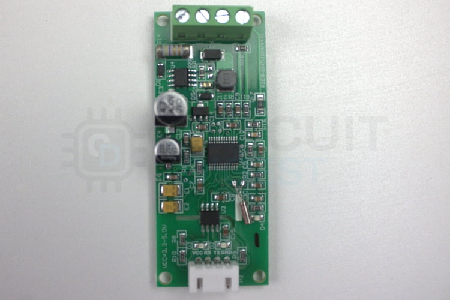

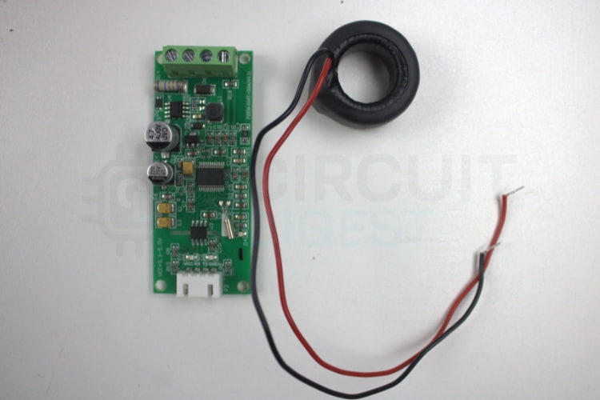

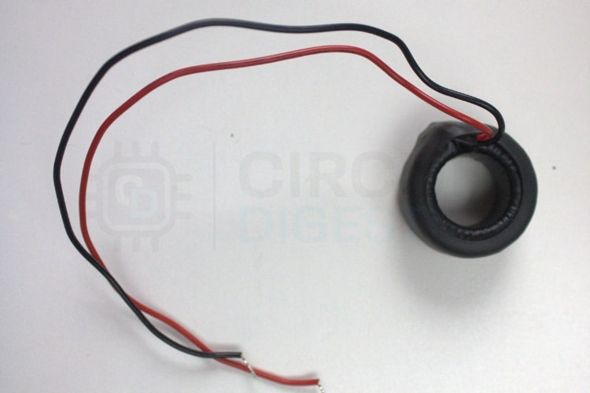

## Circuit and Wiring

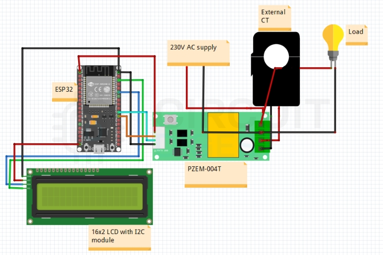

| Connection | ESP32 pin |
|------------|-----------|
| PZEM UART (Serial2) RX | GPIO 16 |
| PZEM UART (Serial2) TX | GPIO 17 |
| LCD I2C SDA | GPIO 21 |
| LCD I2C SCL | GPIO 22 |
| PZEM 5 V and GND | 5 V (VIN) and GND |
| LCD module VCC and GND | 5 V (VIN) and GND |

Notes:

- The CT clamps around the live wire only. Never pass both live and neutral through the CT, because the opposing currents cancel and the reading will be zero.
- The PZEM-004T voltage terminals connect to live and neutral on the load side.
- The TX of the PZEM goes to the RX pin of the ESP32 and vice versa. If you see no data, check that the pin pair is wired the way your firmware expects.

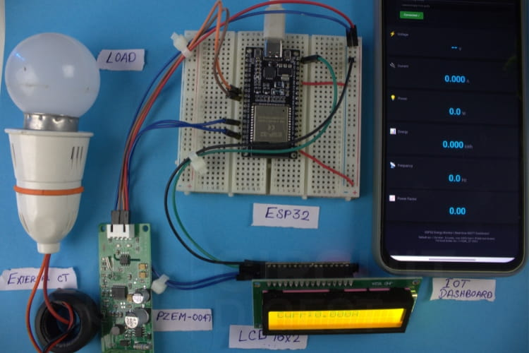

## How It Works

1. **Measurement.** The PZEM-004T measures mains voltage directly and measures current through the external CT on the live wire. From these it computes current, active power, accumulated energy, frequency and power factor internally.
2. **Communication.** The ESP32 requests the values over a UART link using the module's Modbus-RTU protocol, through the `PZEM004Tv30` library.
3. **Conditioning.** The firmware replaces invalid (NaN) readings with 0.0. If the voltage is invalid or below 10 V, the supply is treated as physically off and voltage, current, power, frequency and power factor are forced to zero instantly. Energy is kept, since it is a cumulative total stored in the module.
4. **Local display.** Every 2.5 seconds the LCD switches between three screens: voltage and current, power and energy, frequency and power factor.
5. **Cloud publishing.** Every 2 seconds each value is published as a plain-text number to its own MQTT topic. The same values are printed to the serial monitor.
6. **Visualization.** The dashboard connects to the same broker over WebSockets, subscribes to the topics and updates its display and charts as messages arrive.
7. **Alerting.** If the supply is on, the voltage is above 250 V and at least 60 seconds have passed since the last alert, the ESP32 sends an HTTPS request to the Circuit Digest Cloud API, which delivers an SMS to the configured mobile number.

## Firmware Walkthrough

The firmware is in [Source-Code.ino](Source-Code.ino).

### Libraries

| Library | Purpose |
|---------|---------|
| `Wire.h` | I2C bus for the LCD |
| `LiquidCrystal_I2C.h` | LCD control |
| `PZEM004Tv30.h` | Reading the PZEM-004T over UART |
| `WiFi.h` | Wi-Fi connection |
| `PubSubClient.h` | MQTT client |
| `WiFiClientSecure.h`, `HTTPClient.h` | HTTPS call to the SMS API |

### Configuration constants

| Constant | Meaning |
|----------|---------|
| `ssid`, `password` | Wi-Fi network credentials |
| `mqtt_server`, `mqtt_port` | MQTT broker (default `broker.hivemq.com`, port 1883) |
| `apiKey`, `templateID`, `mobileNumber` | Circuit Digest Cloud SMS credentials, template and recipient |
| `stabilityDelay` | Debounce time (2000 ms) before the on/off state change is confirmed |
| `smsCooldown` | Minimum time between SMS alerts (60000 ms) |

### MQTT topics

| Parameter | Topic |
|-----------|-------|
| Voltage (V) | `avinash/home1/voltage` |
| Current (A) | `avinash/home1/current` |
| Power (W) | `avinash/home1/power` |
| Energy (kWh) | `avinash/home1/energy` |
| Frequency (Hz) | `avinash/home1/frequency` |
| Power factor | `avinash/home1/pf` |

Because the default broker is a public one, other people can publish or subscribe to the same topic names if they guess them. Change the topic prefix to something unique to you.

### Main loop

1. Keep the MQTT connection alive, reconnecting with a random client ID if it drops.
2. Read all six values from the PZEM.
3. Decide whether the AC supply is physically off, and update the debounced `acState`.
4. Build the display values, zeroing instantaneous readings when the supply is off.
5. Send the SMS if the over-voltage condition is met and the cooldown has expired.
6. Every 2 seconds, print to serial and publish to MQTT.
7. Every 2.5 seconds, advance the LCD to the next screen.

## Web Dashboard

The dashboard is a single static file, [Dashboard.html](Dashboard.html). It uses the MQTT.js library for the broker connection and Chart.js for the charts, both loaded from a CDN.

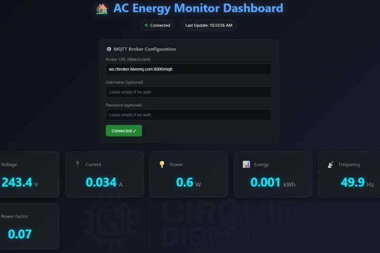

To use it:

1. Open `Dashboard.html` in any modern browser. No server is needed.
2. Leave the default broker URL `ws://broker.hivemq.com:8000/mqtt`, or enter your own WebSocket broker URL (for a local Mosquitto broker this is typically `ws://YOUR_IP:9001`).
3. Click **Connect to Broker**. The status indicator turns to connected, and the dashboard subscribes to all six topics.
4. Live values and charts update as the ESP32 publishes.

The topic names in the `TOPICS` object near the top of the dashboard script must match those in the firmware.

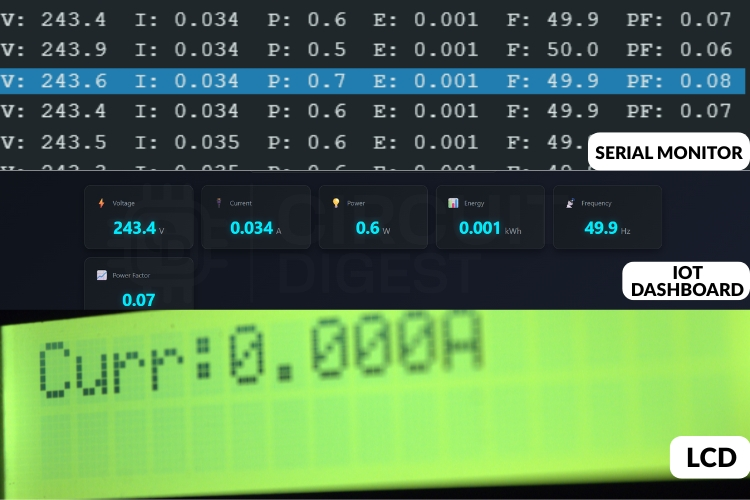

## SMS Alerts

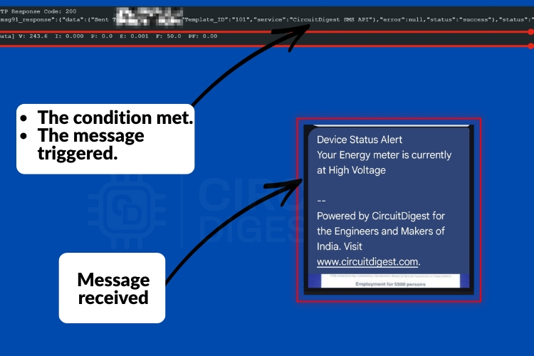

SMS delivery uses the Circuit Digest Cloud API. The firmware sends an HTTPS POST to:

```
https://www.circuitdigest.cloud/api/v1/send_sms?ID=<templateID>
```

with the API key in the `Authorization` header and a JSON body containing the recipient number and two template variables (the device name and the alert type):

```json
{"mobiles":"<number>","var1":"Energy meter","var2":"High Voltage"}
```

Alert condition in the current firmware:

```cpp
if (acState && dispV > 250 && millis() - lastSMS > smsCooldown) {
    sendSMS();
    lastSMS = millis();
}
```

The mobile number must include the country code (for India, begin with 91). The Wi-Fi connection must be active for the alert to be sent.

## Setup and Installation

### 1. Software

1. Install the Arduino IDE and add ESP32 board support through the Boards Manager.
2. Install these libraries from the Library Manager:
   - LiquidCrystal I2C
   - PZEM004Tv30 (by Jakub Mandula)
   - PubSubClient (by Nick O'Leary)
3. Open `Source-Code.ino`.

### 2. Configure the firmware

Edit the following in `Source-Code.ino`:

```cpp
const char* ssid = "YOUR_WIFI_NAME";
const char* password = "YOUR_WIFI_PASSWORD";
const char* apiKey = "YOUR_CIRCUIT_DIGEST_API_KEY";
const char* templateID = "YOUR_TEMPLATE_ID";
const char* mobileNumber = "91XXXXXXXXXX";
```

Also change the MQTT topic prefix if you want private topics, and update `Dashboard.html` to match.

Do not commit real Wi-Fi passwords, API keys or phone numbers to a public repository.

### 3. Upload

Select your ESP32 board and COM port, then upload. Open the serial monitor at 115200 baud to see Wi-Fi and MQTT connection messages and the periodic readings in the form:

```
V:230.1 I:0.452 P:98.5 E:1.24 F:50.0 PF:0.95
```

### 4. View data

Open `Dashboard.html` in a browser and connect to the broker.

## Repository Structure

```
.
|-- Source-Code.ino     ESP32 firmware
|-- Dashboard.html      MQTT web dashboard
|-- README.md           Project documentation
|-- Images/             Photos, circuit and block diagrams, demo GIF
```

## Safety Notes

This project involves mains voltage, which can cause serious injury or death.

- Work only with the supply disconnected while wiring.
- Use a properly insulated enclosure; keep all mains terminals covered.
- Clamp the CT only around the live wire, never around a cable carrying both live and neutral.
- Do not exceed the module's rated voltage and current.
- If you are not experienced with mains wiring, have a qualified person check the setup before powering it.

## Applications

- Smart home energy monitoring
- Over-voltage warning and appliance protection
- Remote tracking of power use at farmhouses and remote sites
- Small industrial load monitoring
- Power outage detection
- Data source for predictive maintenance

## Future Improvements

- Under-voltage, overload and zero-current (load fault) alerts
- Energy cost and billing estimation
- Persistent data logging and analytics
- Authenticated and encrypted MQTT (TLS and credentials)
- Mobile app integration
- Remote relay control to cut off the load on a fault
- Proper certificate validation for the HTTPS SMS call instead of `setInsecure()`

## FAQ

**Why MQTT instead of HTTP?**
MQTT is a lightweight publish/subscribe protocol that uses little bandwidth and delivers updates with low latency, which suits frequent small sensor readings.

**Is Wi-Fi required?**
Yes, for MQTT streaming and SMS alerts. The LCD and serial output work without it, but the current firmware waits for Wi-Fi at start-up.

**Is it safe with mains electricity?**
The PZEM-004T isolates the mains side from the UART side, so the ESP32 is not connected to mains. The mains side itself is still dangerous and must be handled carefully.

**Can it detect a power failure?**
Yes. When voltage reads below 10 V or is invalid, all instantaneous readings are shown as zero and the state is logged as off after the debounce period.

**Why do the values show zero when the load is off?**
The firmware deliberately zeroes voltage, current, power, frequency and power factor when no supply is present, so that old values are never displayed. Accumulated energy is retained.

## Acknowledgements

Developed as part of the Design Lab course EE 396 at the Indian Institute of Technology Guwahati, under the supervision of Prof. Gaurav Trivedi. The project received a grade of 10 in the course.
